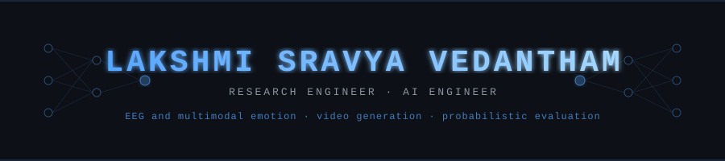
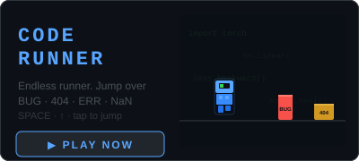

<div align="center">
  
</div>

<br/>

<div align="center">

[](https://sravyavedantham.com)
&nbsp;
[](https://orcid.org/0009-0005-7902-2759)
&nbsp;
[](https://scholar.google.com/citations?user=QuW8DmgAAAAJ)
&nbsp;
[](https://openreview.net/profile?id=~Lakshmi_Sravya_Vedantham1)
<br/>
[](https://www.linkedin.com/in/lakshmisravyavedantham/)
&nbsp;
[](https://dev.to/lakshmisravyavedantham)
&nbsp;
[](https://www.youtube.com/@dumdumhum)

</div>

---

### `IDENTITY`

```yaml
name      : Lakshmi Sravya Vedantham
role      : Research Engineer  ·  AI Engineer & Founder (stealth)
location  : San Jose, California
interests : EEG and multimodal emotion recognition, sleep staging,
            video generation and its evaluation, exact sampling,
            predictive evaluation, coding-agent provenance
writing   : 57 technical articles on Dev.to
```

---

### `PREPRINTS`

With Rajasekhar Josyula, 2026.

1. **Attributing Subagent Work in Coding-Agent Protocol Adapters.** Submitted to AGENT 2027. [doi:10.5281/zenodo.23986760](https://doi.org/10.5281/zenodo.23986760)
2. **The Price of Early Stopping in Exact Sampling.** Preprint. [doi:10.5281/zenodo.23829608](https://doi.org/10.5281/zenodo.23829608)
3. **When Equivalent Models Receive Different Predictive Scores.** Preprint. [doi:10.5281/zenodo.23829693](https://doi.org/10.5281/zenodo.23829693)

---

### `PROJECTS`

| Project | What it is |
|---|---|
| [sound-therapy-viz](https://github.com/LakshmiSravyaVedantham/sound-therapy-viz) | Live sound visualizer that predicts the mood of music in the browser; used at a live concert |
| [gurukul-ai](https://github.com/LakshmiSravyaVedantham/gurukul-ai) | Fully local text-to-video pipeline for kids' educational videos on Apple Silicon |
| [EEG](https://github.com/LakshmiSravyaVedantham/EEG) | Brain-state classification from EEG signals |
| [Music_classifier](https://github.com/LakshmiSravyaVedantham/Music_classifier) | Music genre classifier from audio features, with a Gradio app |

---

### `PLAY`

<div align="center">
  <a href="https://LakshmiSravyaVedantham.github.io/LakshmiSravyaVedantham/game/runner/"></a>
  &nbsp;
  <a href="https://LakshmiSravyaVedantham.github.io/LakshmiSravyaVedantham/game/2048/"></a>
</div>
